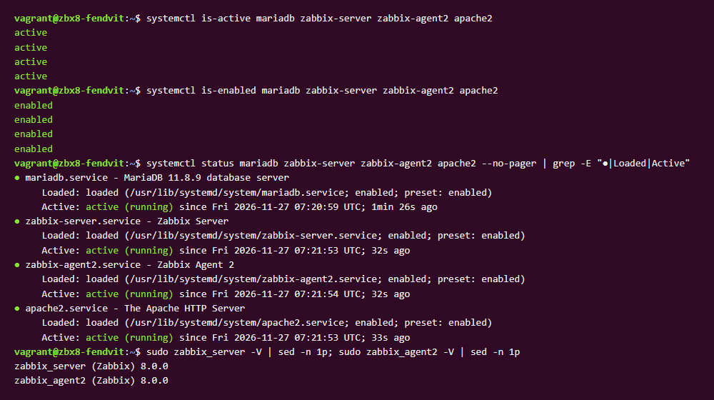
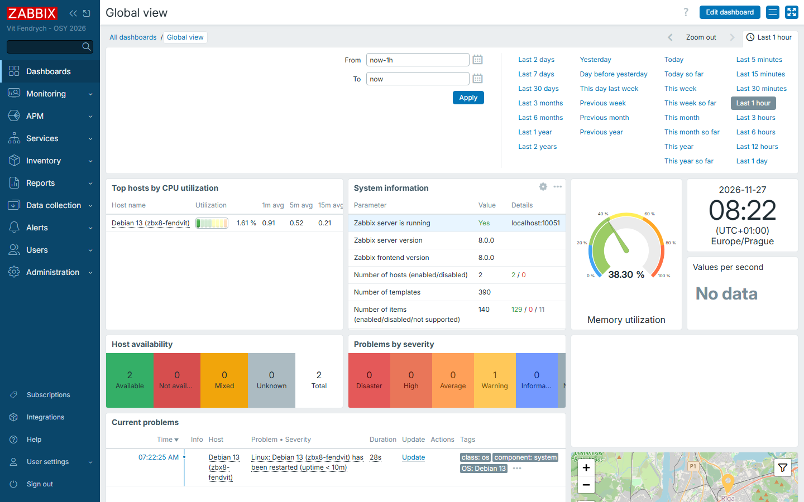
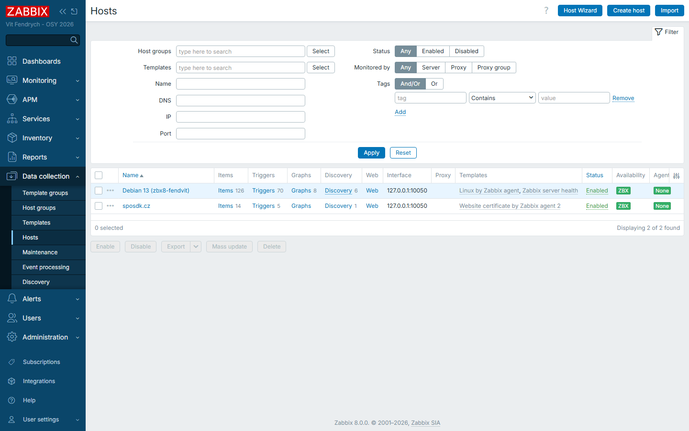
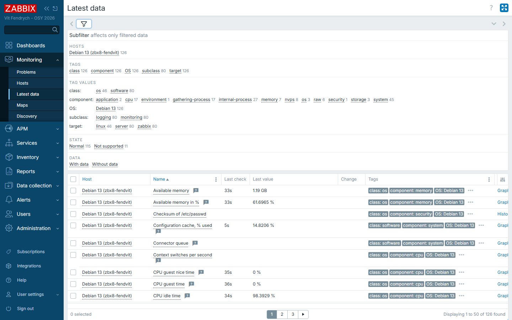
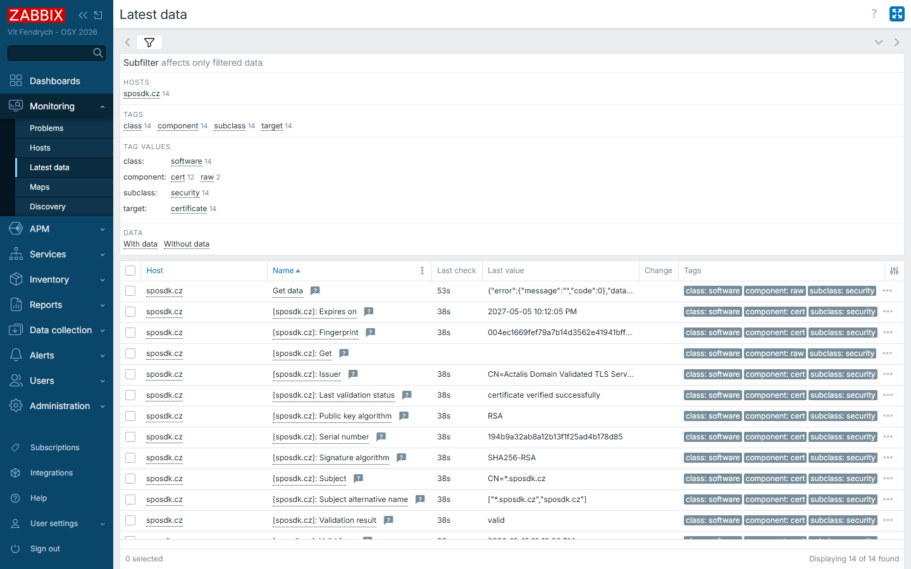

# Zabbix 8.0 LTS server na Debianu 13


Cílem bylo udělat instalaci Zabbix serveru 8.0 LTS, která se celá spustí příkazem `vagrant up`. Ve virtuálce s Debianem 13 běží MariaDB, Zabbix server, webové rozhraní přes Apache a Zabbix Agent 2, který hlídá ten samý server. Nic se ve virtuálce nemusí instalovat ručně.

## Co je v repozitáři

- `Vagrantfile` - box `bento/debian-13`, 2 CPU a 2 GB RAM, hostname `zbx8-fendvit`. Port 80 z virtuálky je přesměrovaný na `127.0.0.1:8080` a SSH na `127.0.0.1:2206`, takže web ani SSH nejsou vidět z jiných počítačů v síti.
- `scripts/install-zabbix-server.sh` - přidá oficiální repozitář Zabbix 8.0 pro Debian 13, nainstaluje MariaDB, Zabbix server, web, Apache a agenta 2, vytvoří databázi, importuje schéma, nastaví konfiguraci a spustí služby.
- `scripts/configure-zabbix-hosts.sh` - přes Zabbix API přidá místní Debian jako hosta, naimportuje hosta `sposdk.cz` a změní výchozí heslo účtu Admin.
- `Zabbix/export/sposdk.cz_hosts.yaml` - export hosta `sposdk.cz` ze zadání.
- `Images/` - snímky obrazovky.

## Předpoklady

Vagrant a VirtualBox (já mám Vagrant 2.4.9 a VirtualBox 7.2.4 na Windows 11), připojení k internetu a aspoň 2 GB volné RAM. Port 8080 na počítači nesmí být obsazený.

## Spuštění

```console
git clone https://github.com/sposdknl/fendvit-osy-2026-zbx8-inst.git
cd fendvit-osy-2026-zbx8-inst
vagrant up
```

První `vagrant up` trvá několik minut, protože se stahují balíčky. Do virtuálky se dostanu přes `vagrant ssh`. Když chci skripty pustit znovu, stačí `vagrant provision`. Databáze se tím nesmaže, schéma se importuje jen tehdy, když v databázi ještě není tabulka `dbversion`. Hosti se taky vytvoří jen jednou. Vypnutí je `vagrant halt`, smazání virtuálky `vagrant destroy`.

## Web

Web je na adrese **http://127.0.0.1:8080/zabbix/** (adresa http://127.0.0.1:8080/ na něj přesměruje). Přihlašuje se jako `Admin`. PHP wizard se neprochází, protože skript rovnou vytvoří `/etc/zabbix/web/zabbix.conf.php`. V záhlaví webu je název serveru `Vit Fendrych - OSY 2026`.

## Hesla

V repozitáři ani v README žádné heslo není. Skript si heslo k databázi vygeneruje až ve virtuálce přes `openssl rand` a uloží ho do `/root/zabbix-secrets/db-password`, kam má přístup jen root. Odtud ho dává do `zabbix_server.conf` (práva 640, root:zabbix) a do `zabbix.conf.php` (práva 400, www-data). Při dalším `vagrant provision` se použije stejné heslo, takže se nic nerozbije.

Výchozí heslo `zabbix` k účtu Admin druhý skript hned změní na náhodné a uloží ho do `/root/zabbix-secrets/admin-password`. Zobrazím ho takhle:

```console
vagrant ssh -c "sudo cat /root/zabbix-secrets/admin-password"
```

## Hosti v Zabbixu

V čerstvé databázi už je host `Zabbix server` s adresou `127.0.0.1:10050` a šablonami `Linux by Zabbix agent` a `Zabbix server health`. Je to přesně ten Debian, na kterém všechno běží, takže ho skript přes API jen přejmenuje na `zbx8-fendvit` (viditelné jméno `Debian 13 (zbx8-fendvit)`) a přidá mu štítek `OS: Debian 13`. Šablona `Linux by Zabbix agent` funguje i s agentem 2. V konfiguraci agenta je `Server=127.0.0.1`, `ServerActive=127.0.0.1` a `Hostname=zbx8-fendvit`, aby seděl s názvem hosta.

Host `sposdk.cz` se importuje ze souboru `Zabbix/export/sposdk.cz_hosts.yaml` přes `configuration.import`. Export je ze Zabbixu 7.0, ale Zabbix 8.0 ho při importu sám převedl, takže jsem ho nemusel upravovat. Host má šablonu `Website certificate by Zabbix agent 2` a rozhraní `127.0.0.1:10050`, takže certifikát `https://sposdk.cz` stahuje můj místní agent 2.

## Ověření

Po `vagrant up` jsem otevřel web, přihlásil se a zkontroloval služby ve virtuálce:

```console
vagrant ssh
systemctl is-active mariadb zabbix-server zabbix-agent2 apache2
systemctl is-enabled mariadb zabbix-server zabbix-agent2 apache2
sudo zabbix_server -V
sudo zabbix_agent2 -V
sudo zabbix_agent2 -t "web.certificate.get[sposdk.cz,443]"
```

Všechny čtyři služby jsou `active` a `enabled`, server i agent mají verzi 8.0.0:



Web s mým názvem serveru v levém horním rohu. Na dashboardu je vidět, že server běží, verze 8.0.0 a dva dostupní hosti:



Oba hosti mají zelenou ikonu ZBX, takže se s agentem dá spojit:



Aktuální data z agenta na místním Debianu (Monitoring → Latest data):



Certifikát `sposdk.cz`: výsledek `valid`, vydavatel Actalis, platnost do 5. 5. 2027:



Projekt jsem nakonec ověřil úplně od začátku: `vagrant destroy -f`, `vagrant up` a hned potom ještě `vagrant provision`. Při druhém běhu skript vypsal, že schéma už existuje, hosti už existují a heslo už bylo změněné, a nic nespadlo.

## Problémy

- Napoprvé skript spadl na kontrole, jestli je Zabbix z repozitáře zabbix.com: `apt-cache policy zabbix-server-mysql | grep -q repo.zabbix.com`. `grep -q` skončí hned po prvním nálezu a zavře rouru, `apt-cache` pak dostane SIGPIPE a se `set -o pipefail` je to chyba, i když se všechno nainstalovalo správně. Kontrolu jsem přepsal na `dpkg-query -W -f='${Version}'` a porovnávám, jestli verze obsahuje `:8.0.` (balíček z Debianu je 7.0).
- Ve výchozím repozitáři Debianu 13 je Zabbix 7.0, proto se musí nejdřív přidat repozitář zabbix.com. Adresa pro 8.0 má v cestě `/release/`, bez toho vrací 404.
- Nejdřív jsem vedle výchozího hosta `Zabbix server` vytvořil nového hosta a ten výchozí vypnul, aby se agent neptal dvakrát. Jenže widgety na dashboardu (paměť, grafy) jsou navázané právě na výchozího hosta, takže ukazovaly „No data“. Proto ho teď skript přejmenuje místo vypínání.
- Kvůli Windows mám v repozitáři `.gitattributes`, aby se skripty uložily s konci řádků LF. S CRLF by je bash ve virtuálce nespustil.

## Odkazy

- [Stažení Zabbixu (Debian 13, MySQL, Apache)](https://www.zabbix.com/download)
- [Instalace z balíčků](https://www.zabbix.com/documentation/8.0/en/manual/installation/install/packages)
- [Požadavky Zabbixu 8.0](https://www.zabbix.com/documentation/8.0/en/manual/installation/requirements)
- [Zabbix API](https://www.zabbix.com/documentation/8.0/en/manual/api)
